官方的仓库：https://github.com/sdbds/SageAttention-for-windows

因为官方仓库没有适配秋叶整合包V2的SageAttention2.2预编译版本。为了玩Z-image我只能自己编译一个。

效果还是很给力的，FP8模型+FP16的seedvr2出4K图在我的4080S+32GRAM下甚至可以控制在50S左右（非首次出图时、每次启动的第一张图会比较慢）。

中间踩了很多坑，什么依赖库缺失、叶整合包自带cu129装最新的13.0版本cuda Toolkit就会编译报错、Microsoft Visual C++缺失、Triton最新版3.5不匹配torch2.8必须降级3.4否则SageAttention会报错（Error running sage attention: Triton only support CUDA 10.0 or higher, but got CUDA version: 12.8, using pytorch attention instead.）

好不容易编译出来了，独乐乐不如众乐乐，也让我踩的坑更有价值。

参考安装教程：
如何在最新秋叶整合包(ComfyUI-aki-v2)中安装SageAttention最新版（2.2.0）

注意：以下操作全部在秋叶整合包自带的CMD窗口中运行！可以免去配置环境变量和被系统自带的python干扰的风险！

秋叶整合包下载地址：https://t.bilibili.com/1099726378314498050

Z-image模型和推荐工作流下载：https://www.bilibili.com/video/BV1pRSMBHERD

comfyui基础教程参考：https://www.bilibili.com/video/BV11pHtzoEsf/

（最好按照工作流作者的整合包里安装的插件列表，在秋叶V2里再安装一遍，工作流就不会报错了）（为什么不用工作流作者自己的整合包呢？emmm其实也是可以的 ，但是那个秋叶整合包版本比较旧是V1的）（安装完记得更新comfyui到最新开发版才能跑）

1.确认python版本和Torch版本

在CMD中输入：“python -m pip list | findstr torch”。如果你的秋叶整合包版本正确，应该可以看到：

open_clip_torch ：3.2.0

torch ：2.8.0+cu129

torchaudio ：2.8.0+cu129

torchsde： 0.2.6

torchvision ：0.23.0+cu129

输入：python --version，秋叶整合包自带的python版本应该是cpython-312

升级强迫症可选：python -m pip install --upgrade pip

2.安装依赖Triton 3.4

（Triton的最新版已经更新到3.5，但是官方文档显示torch 2.8.0只能匹配3.5之前的版本，所以不要试图安装最新版，否则会报错Error running sage attention: Triton only support CUDA 10.0 or higher, but got CUDA version: 12.8, using pytorch attention instead.）

命令：python -m pip install -U "triton-windows<3.5"

如果你之前安装了其他版本的triton或者triton-windows需要全部卸载（通过python -m pip list | findstr triton可以判断是否已经安装，默认情况下是空输出）

python -m pip uninstall triton triton-windows

3.下载我编译好的SageAttention。（在本仓库的releases中）

注意，我编译的这个版本，仅适配torch 2.8.0+cu129、python3.12的环境！！！（也就是不适配V1版本的整合包）

安装方法：把下载下来的这个 .whl 文件，放到 C:\AI\ComfyUI-aki-v2\ComfyUI 这个文件夹里。（注意：C:\AI\ComfyUI-aki-v2\ 要替换为你秋叶整合包的安装位置！）

在CMD中输入：python -m pip install sageattention-2.2.0-cp312-cp312-win_amd64.whl

4.验证安装

python -m pip list | findstr sageattention

正常情况下，第一次跑图比较慢，等系统编译 好CUDA 核就能正常加速了。

疑难杂症排解：

1.安装过程中出现明显 ERROR / Failed to build，请把全部日志复制下来丢给AI（国产的qwen3-max推荐），让AI判断缺了什么依赖并给出安装命令。

2.编译好的 .whl 通常不再需要本地 CUDA Toolkit 以及 Visual Studio.
如果出现报错。请到 https://docs.nvidia.com/cuda/cuda-toolkit-release-notes/index.html  查询你显卡驱动对应的CUDA Toolkit的版本。（显卡驱动版本可在NVDIA控制面板查看）
然后到 https://developer.nvidia.com/cuda-toolkit-archive   下载对应版本。

特别提醒：秋叶整合包的cu129最高只能安装到CUDA Toolkit 12.9 Update 1！安装最新版本会报错！如需安装Visual Studio，需要勾选“Windows 10 SDK” 或者 “Windows 11 SDK”（通常在“使用 C++ 的桌面开发”那一栏的右侧详细列表里）。

--- -->

# SageAttention
<!-- We are continuously updating more features. You could **Star** and **Watch** our repository to stay updated.

--- -->
This repository provides the official implementation of SageAttention, SageAttention2, and SageAttention2++, which achieve surprising speedup on most GPUs without lossing accuracy across all models in a plug-and-play way.

**SageAttention: Accurate 8-Bit Attention for Plug-and-play Inference Acceleration**  
Jintao Zhang, Jia Wei, Haofeng Huang, Pengle Zhang, Jun Zhu, Jianfei Chen  
Paper: https://arxiv.org/abs/2410.02367

**SageAttention2: Efficient Attention with Thorough Outlier Smoothing and Per-thread INT4 Quantization**  
Jintao Zhang, Haofeng Huang, Pengle Zhang, Jia Wei, Jun Zhu, Jianfei Chen  
Paper: https://arxiv.org/abs/2411.10958

**SageAttention3: Microscaling FP4 Attention for Inference and An Exploration of 8-Bit Training**  
Jintao Zhang, Jia Wei, Haoxu Wang, Pengle Zhang, Xiaoming Xu, Haofeng Huang, Kai Jiang, Jianfei Chen, Jun Zhu  
Paper: https://arxiv.org/abs/2505.11594


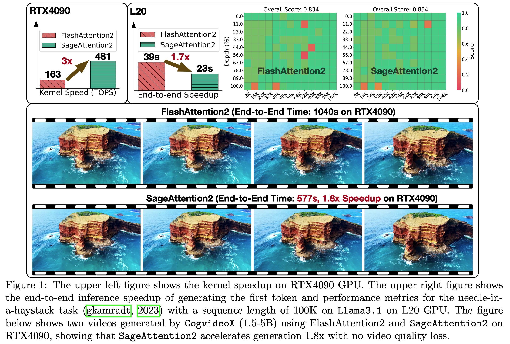
*Note: [SageAttention2++](https://arxiv.org/pdf/2505.21136) achieves higher speed while maintaining the same accuracy performance.*

## Current Features
<!-- This is a beta release of SageAttention2. We welcome any feedback on accuracy, performance issues, bugs, feature requests, or suggestions. Please feel free to open an issue or launch a pull request! -->

+ Optmized kernels for **Ampere, Ada and Hopper GPUs.**
+ INT8 quantization and smoothing for $QK^\top$ with support for varying granularities.
+ FP8 quantization for $PV$, and FP16 accumulator for FP8/FP16 $PV$.
+ Two-level accumulation strategy for $PV$ to improve accuracy in FP8 MMA and WGMMA.
+ Support `torch.compile` with non-cudagraphs mode and distributed inference.


## Project Updates
- [2025-09-27]: 🎉 [SageAttention3](https://arxiv.org/abs/2505.11594) is accepted by NeurIPS 2025 as a **Spotlight** paper! 
- [2025-09-27]: The code of [SageAttention3](https://arxiv.org/abs/2505.11594) is released in this repository at  [sageattention3_blackwell](./sageattention3_blackwell/). We would still greatly appreciate it if you could take a moment to fill out the Form in [Huggingface](https://huggingface.co/jt-zhang/SageAttention3). Please note that since SageAttention2 is more accurate, we still recommend using SageAttention2 for precision-sensitive applications.
- [2025-07-01]: The code of [SageAttention2++](https://arxiv.org/pdf/2505.21136) is released in this repository. We would still greatly appreciate it if you could take a moment to fill out the Form in [Huggingface](https://huggingface.co/jt-zhang/SageAttention2_plus). Thank you very much!

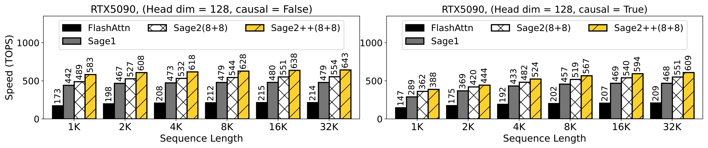

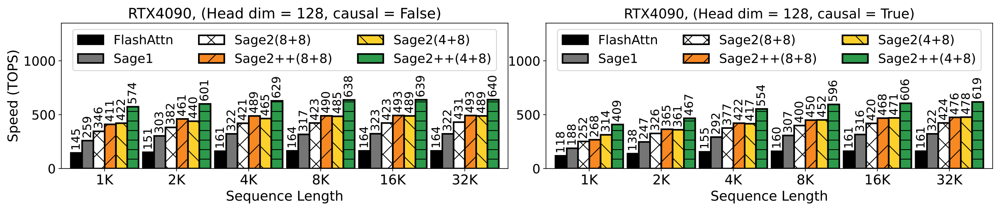

- [2025-06-19]: [Sparse SageAttention1 API](https://github.com/jt-zhang/Sparse_SageAttention_API) and [Sparse SageAttention2 API](https://github.com/thu-ml/SpargeAttn) can compute attention with any block sparse pattern very fast.
- [2025-05-02]: 🎉SageAttention2 and [SpargeAttn](https://github.com/thu-ml/SpargeAttn) are accepted by ICML 2025! 
- [2025-02-25]: 🔥 We release [SpargeAttn](https://github.com/thu-ml/SpargeAttn), a sparse attention based on SageAttention2, which could acclerate any model without training.
- [2025-02-15]: 🔥 The compilation code is updated to support RTX5090! On RTX5090, SageAttention reaches 560T, 2.7x faster than FlashAttention2!
- [2025-01-28]: 🔥⚡SageAttention is now available on Hopper GPUs (H100, H800, H20)! It matches the speed of FlashAttention3-FP8 but offers **much better accuracy!**

| **FlashAttention2** | **FlashAttention3** | **FlashAttention3-FP8** | **SageAttention** |
|----------------------|----------------------|----------------------|----------------------|
|  |   |  |  |
| **25'34''** | **17'32''** | **12'14''** | **12'07''** |

*Results for [CogVideoX1.5-5B](https://huggingface.co/THUDM/CogVideoX1.5-5B) on NVIDIA H20 GPU*

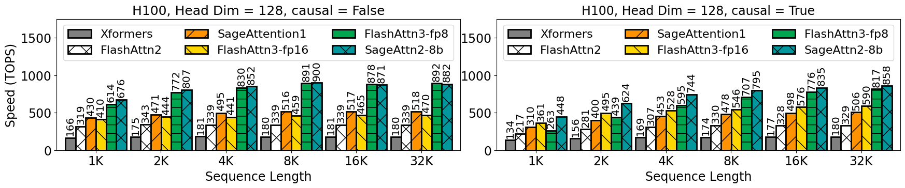

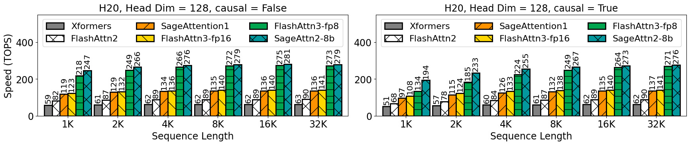

- [2025-01-24]: 🎉SageAttention is accepted by ICLR 2025! 
- [2024-12-20]: 🔥Update the [SageAttention2 Paper](https://arxiv.org/abs/2411.10958).   

- [2024-12-20]: 🔥Release SageAttention 2.0.1 Beta! In this version, we introduce a new feature: per-thread quantization, which offers finer granularity while maintaining hardware efficiency.
- [2024-11-21]: 🔥SageAttention 2.0.0 beta is released! Now SageAttention has measured speedup on L20, L40, A100, A800, and A6000, RTX3090 and RTX4090.
- [2024-11-12]: Support for `sageattn_varlen` is available now.
- [2024-11-11]: Support for different sequence lengths between `q` and `k,v`,  `(batch_size, head_num, seq_len, head_dim)` or `(batch_size, seq_len, head_num, head_dim)` input shapes, and `group-query attention` is available now.


## Installation
### Base environment
+ `python>=3.9`   , `torch>=2.3.0`  , `triton>=3.0.0` 
- `CUDA`:
  + `>=12.8` for Blackwell or SageAttention2++
  + `>=12.4` for fp8 support on Ada
  + `>=12.3` for fp8 support on Hopper
  + `>=12.0` for Ampere
+ `flash-attn` for benchmarking

### Install Package

For SageAttention V1 in Triton (slower than SageAttention V2/V2++/V3), refer to [SageAttention-1](https://github.com/thu-ml/SageAttention/tree/sageattention-1) branch and install using pip: `pip install sageattention==1.0.6`

To use SageAttention 2.2.0 (containing SageAttention2++), you can install using pip:
```
pip install sageattention==2.2.0 --no-build-isolation
```

**Or** you can compile from source:
```
git clone https://github.com/thu-ml/SageAttention.git
cd SageAttention 
export EXT_PARALLEL=4 NVCC_APPEND_FLAGS="--threads 8" MAX_JOBS=32 # Optional
python setup.py install
```

To benchmark the speed against FlashAttention3, please compile FlashAttention3 from source:
```
git clone https://github.com/Dao-AILab/flash-attention.git --recursive
git checkout b7d29fb3b79f0b78b1c369a52aaa6628dabfb0d7 # 2.7.2 release
cd hopper
python setup.py install
```

## How to Use
```python
from sageattention import sageattn
attn_output = sageattn(q, k, v, tensor_layout="HND", is_causal=False)
```
+ `q, k, v` are **FP16/BF16** dtype with the shape `(batch_size, head_num, seq_len, head_dim)` using default `tensor_layout="HND"`. For shape `(batch_size, seq_len, head_num, head_dim)`, set `tensor_layout="NHD"`. 
+ `is_causal` determines the use of a causal mask.

### Available APIs:
+ `sageattn`: Automatically selects the optimal kernel based on the GPU to achieve a good performance-accuracy trade-off.
+ `sageattn_qk_int8_pv_fp16_triton`: INT8 quantization for $QK^\top$ and FP16 for $PV$ using Triton backend.
+ `sageattn_qk_int8_pv_fp16_cuda`: INT8 quantization for $QK^\top$ and FP16 for $PV$ using CUDA backend.
+ `sageattn_qk_int8_pv_fp8_cuda`: INT8 quantization for $QK^\top$ and FP8 for $PV$ using CUDA backend. (Note that setting `pv_accum_dtype=fp32+fp16` corresponds to SageAttention2++.)
+ `sageattn_qk_int8_pv_fp8_cuda_sm90`: INT8 quantization for $QK^\top$ and FP8 for $PV$ using CUDA backend, specifically optimized for Hopper GPUs.
+ `sageattn_varlen`: INT8 quantization for $QK^\top$ and FP16 for $PV$ using Triton backend. Support for varying sequence lengths within the same batch.

For optimal speed and accuracy performance on custom devices and models, we strongly recommend referring to the [this file](./sageattention/core.py) for detailed guidance.

> **Note:**
Support for different sequence lengths between `q` and `k,v` and `group-query attention` is available.


### Plug-and-play Example

We can replace `scaled_dot_product_attention` easily. 
We will take [CogvideoX](https://huggingface.co/zai-org/CogVideoX-2b) as an example:

Add the following codes and run
```diff
import torch.nn.functional as F

+ from sageattention import sageattn
+ F.scaled_dot_product_attention = sageattn

```

Specifically,

```bash
cd example
python cogvideox_infer.py --model cogvideox-2b --compile --attention_type sage
```

**You can get a lossless video in** `./example/videos/<model>/<attention_type>/` **faster than by using** `--attention_type sdpa`. More examples and guidance can be found under the `example/` directory.

> **Note:** Not all models works with `F.scaled_dot_product_attention = sageattn`. Technically, you should replace the original Attention by modifying the `Attention Class` of the target model. For image and video models, we suggest only replacing the attention in DiT (see `example/modify_mochi.py` for detail).

### Kernel Benchmarking
We provide a benchmarking script to compare the speed of different kernels including SageAttention, FlashAttention2 and FlashAttention3. Please refer to the `benchmark/` directory for more details.
 
## Performance
### Speed of Kernels

`8+8` means the kernel with INT8 quantization for $QK^\top$ and FP8 quantization for $PV$. `8+16` uses FP16 with FP16 accumulator for $PV$.


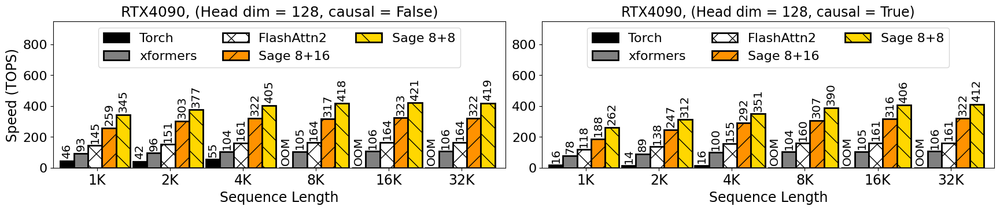

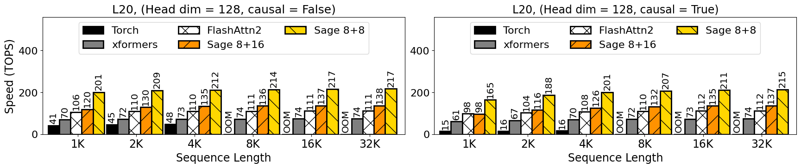


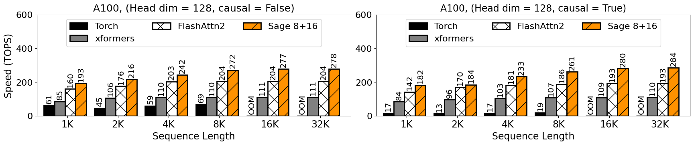

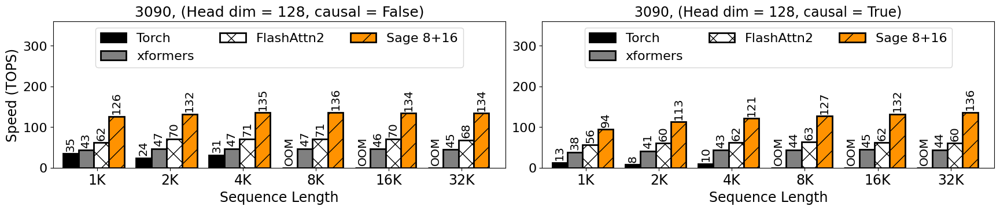

> **Note:** The TOPS results refer only to the Attention Kernel, excluding the quantization and smoothing.

### End-to-end Performance
#### **End-to-End Accuracy:**


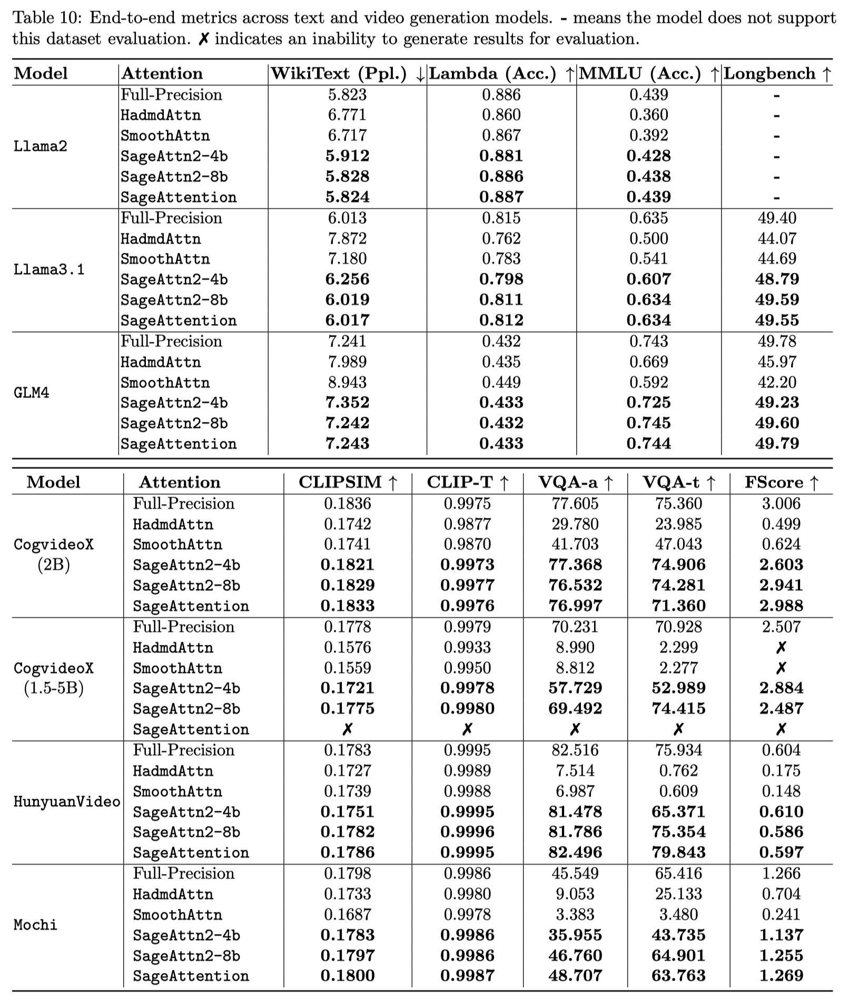

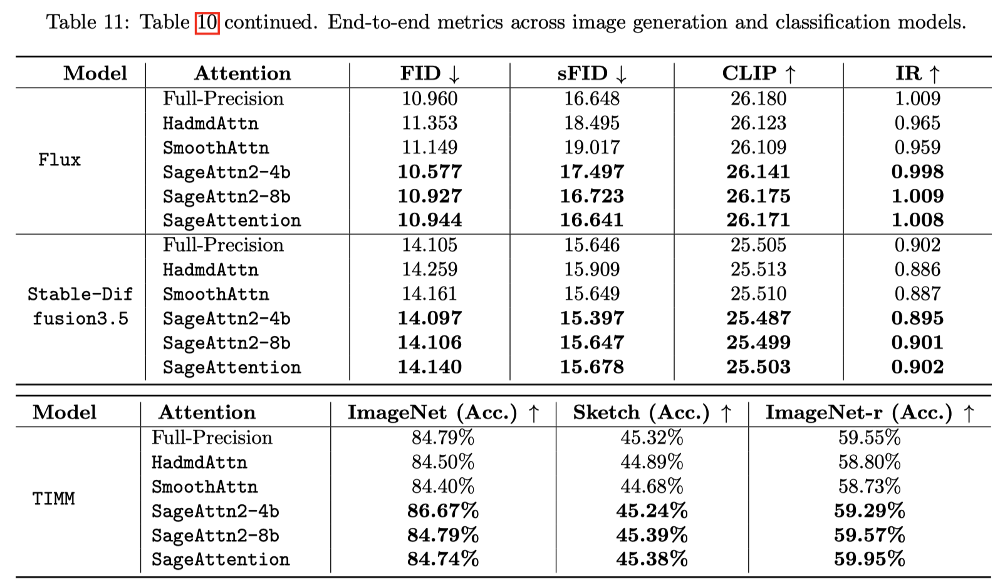

#### **End-to-End Speedup:**

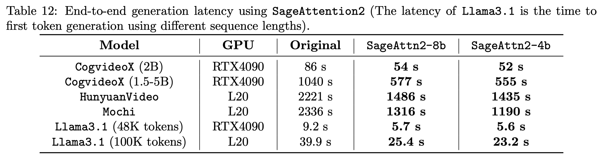
*Note: SageAttention2++ achieves higher speed.*

## Citation
**If you use this code or find our work valuable, please cite:**
```
@inproceedings{zhang2025sageattention,
  title={SageAttention: Accurate 8-Bit Attention for Plug-and-play Inference Acceleration}, 
  author={Zhang, Jintao and Wei, Jia and Zhang, Pengle and Zhu, Jun and Chen, Jianfei},
  booktitle={International Conference on Learning Representations (ICLR)},
  year={2025}
}
@inproceedings{zhang2024sageattention2,
  title={Sageattention2: Efficient attention with thorough outlier smoothing and per-thread int4 quantization},
  author={Zhang, Jintao and Huang, Haofeng and Zhang, Pengle and Wei, Jia and Zhu, Jun and Chen, Jianfei},
  booktitle={International Conference on Machine Learning (ICML)},
  year={2025}
}
@article{zhang2025sageattention2++,
  title={Sageattention2++: A more efficient implementation of sageattention2},
  author={Zhang, Jintao and Xu, Xiaoming and Wei, Jia and Huang, Haofeng and Zhang, Pengle and Xiang, Chendong and Zhu, Jun and Chen, Jianfei},
  journal={arXiv preprint arXiv:2505.21136},
  year={2025}
}
@article{zhang2025sageattention3,
  title={SageAttention3: Microscaling FP4 Attention for Inference and An Exploration of 8-Bit Training},
  author={Zhang, Jintao and Wei, Jia and Zhang, Pengle and Xu, Xiaoming and Huang, Haofeng and Wang, Haoxu and Jiang, Kai and Zhu, Jun and Chen, Jianfei},
  journal={arXiv preprint arXiv:2505.11594},
  year={2025}
}
```
